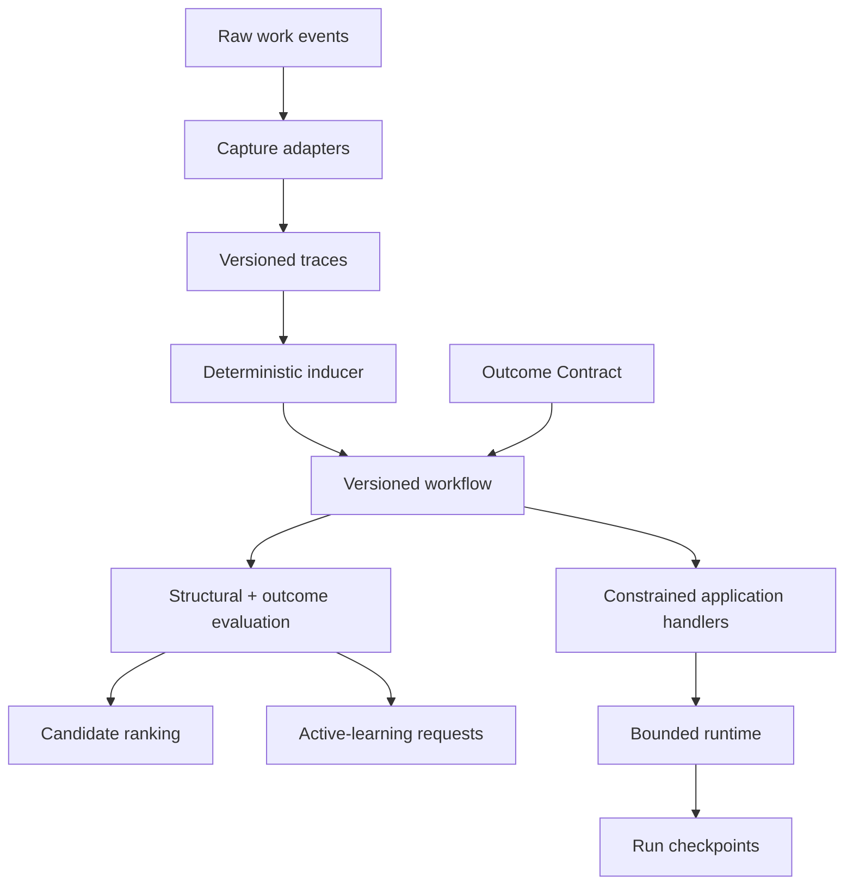

# Architecture

Taskprint separates observation, induction, evaluation, and execution so no model or agent
runtime becomes a hidden source of truth.

## Design decisions

1. **Portable artifacts over proprietary runtime state.** Trace and workflow JSON can be
   inspected without Taskprint Cloud.
2. **Deterministic baseline first.** Identical inputs and configuration produce the same
   topology and fingerprint.
3. **Application-owned effects.** Taskprint never turns an induced action name directly into
   an external API call.
4. **Failure evidence is first-class.** Nodes and edges retain success/failure counts.
5. **Uncertainty remains visible.** Support, observed counts, probabilities, and Wilson lower
   bounds are stored rather than collapsed into a confident narrative.
6. **Bounded execution.** Step limits, visit limits, timeouts, and route validation prevent
   accidental unbounded workflow traversal.
7. **Objectives are explicit.** Weighted outcome metrics are separate from hard constraints, so
   speed or cost can never silently compensate for a prohibited action.
8. **Optimization requires evidence.** Candidate designs are ranked from supplied observations;
   Taskprint does not invent performance measurements or imply causality from topology.
9. **Human review is a runtime state.** A review constraint pauses before or after the relevant
   action and is persisted as `needs_review` rather than being treated as a handler failure.

## Current induction algorithm

The v0.3 inducer creates a directly-follows graph over canonical event signatures. It merges
semantically identical nodes, counts observed transitions, extracts stable and variable
parameters, identifies graph cycles, and estimates support. This works well when collectors
already provide consistent semantic events.

It does not yet solve semantic alignment between unrelated selectors, infer hidden goals from
video, discover hierarchical subtasks, or learn branch predicates. Those are separate research
problems and are intentionally not concealed behind an LLM prompt.

## Optimization boundary

The inducer learns topology from demonstrations. The objective engine scores observed outcomes,
rejects infeasible candidates, and ranks feasible alternatives. The active-learning engine then
identifies sparse branches and missing measurements. These components intentionally do not mutate
a production workflow automatically: an application must collect comparable evidence, approve the
new version, and promote it through its own release process.
